<picture>
  <source media="(prefers-color-scheme: dark)" srcset="./dark.svg">
  <source media="(prefers-color-scheme: light)" srcset="./light.svg">
  
</picture>

# Hey, I'm Thejas 👋

**B.E. Artificial Intelligence & Machine Learning student**  
M. S. Ramaiah University of Applied Sciences · Expected graduation: 2028

*Learning by building practical tools, automation workflows, and software projects.*

---

## About me

- 🎓 Studying **Artificial Intelligence and Machine Learning**.
- 🧠 Exploring AI/ML, Python programming, data, and software development.
- 🛠️ Interested in turning ideas into useful tools through automation and web development.
- 🌱 Focused on learning by building, improving my fundamentals, and shipping projects.

## Featured projects

| Project | What it does | Links |
|---|---|---|
| **Tools Toolkit** | A collection of browser-based utilities, including calculators and generators. | [Website](https://calctoolkits.online) |
| **GK Shorts Automation** | A Python-based workflow for generating general-knowledge quiz videos from structured questions. | [Repository](https://github.com/Thejas992005/gk-shorts-bot) |
| **Student Information System** | An academic software project focused on student information management. | Project details coming soon |

## Technology I work with

  
  
  
  
  
  
  

## Current direction

I'm strengthening my foundations in programming and AI/ML while building practical projects in automation, web tools, and software systems.

## GitHub contributions

<picture>
  <source media="(prefers-color-scheme: dark)" srcset="https://raw.githubusercontent.com/Thejas992005/github-snake/output/github-snake-dark.svg">
  <source media="(prefers-color-scheme: light)" srcset="https://raw.githubusercontent.com/Thejas992005/github-snake/output/github-snake.svg">
  
</picture>

> To enable the contribution snake, create the `Thejas992005/github-snake` repository and configure the GitHub Actions workflow. Until that repository and workflow exist, the animation will not load.

## Connect

- GitHub: [@Thejas992005](https://github.com/Thejas992005)
- LinkedIn: [Thejas Gowda](https://www.linkedin.com/in/thejas-gowda-12581833a/)
- Website: [calctoolkits.online](https://calctoolkits.online)

---

  Always learning. Always building. One project at a time.

